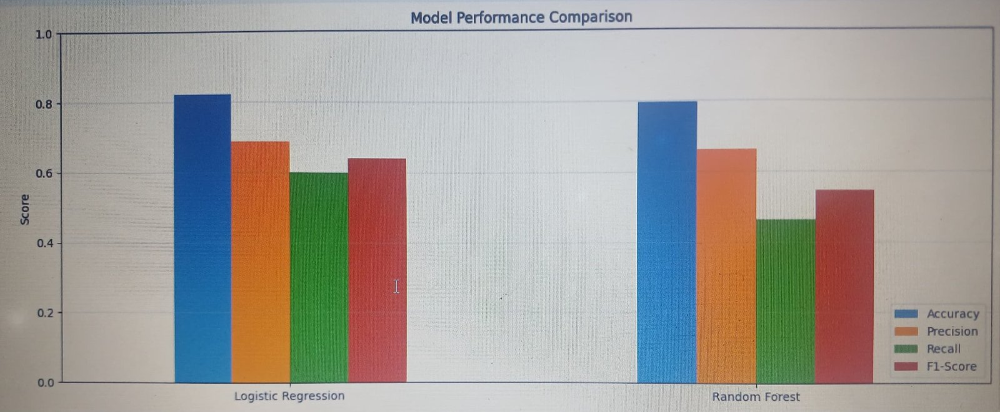
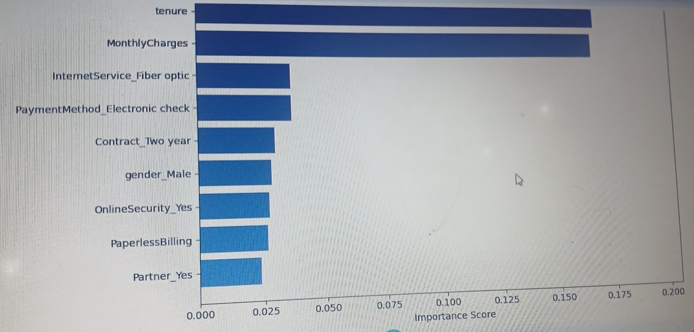
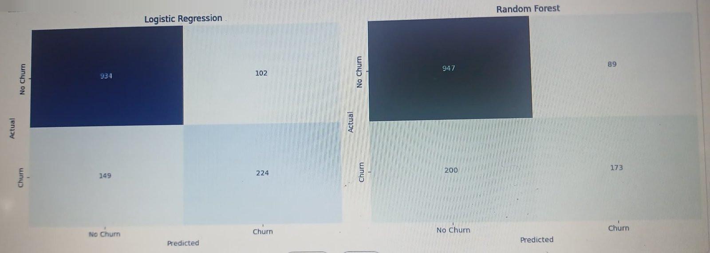

# Telecom Customer Churn Prediction

| Model Performance Comparison | Top Churn Drivers |
|:---:|:---:|
|  |  |

Machine learning capstone project (Group Kilo) that predicts which telecom customers are likely to cancel their service, and identifies the factors that drive churn so the business can act on them.

## Results at a Glance

| Metric    | Logistic Regression (best) | Random Forest |
|-----------|:--------------------------:|:-------------:|
| Accuracy  | **82.19%**                 | 79.49%        |
| Precision | **68.71%**                 | 66.03%        |
| Recall    | **60.05%**                 | 46.38%        |
| F1-Score  | **0.6409**                 | 0.5449        |

Logistic Regression wins on every metric and is also simpler, faster and easier to interpret.

## Dataset

- **Source:** [IBM Telco Customer Churn (Kaggle)](https://www.kaggle.com/datasets/blastchar/telco-customer-churn)
- **File:** `WA_Fn-UseC_-Telco-Customer-Churn.csv` (not included in this repo)
- **Size:** 7,043 customers, 21 raw columns (30 model features after encoding)
- **Target:** `Churn` (Yes / No)
- **Class balance:** 1,869 churned (26.54%), 5,174 stayed (73.46%)

Columns cover customer demographics (gender, senior citizen, partner, dependents), account details (tenure, contract, payment method, paperless billing, monthly and total charges) and services used (phone, internet, security, backup, streaming, tech support).

## Methodology

1. **Exploration:** churn distribution (bar and pie charts) and summary statistics.
2. **Cleaning:**
   - Drop `customerID`.
   - Map `Churn` to 1 / 0.
   - Convert `TotalCharges` to numeric; fill the 11 blank values with 0 (brand new customers).
3. **Encoding:**
   - `PhoneService` and `PaperlessBilling` mapped Yes / No to 1 / 0.
   - Remaining categorical columns one-hot encoded with `drop_first=True`.
4. **Split:** 80% train (5,634 rows), 20% test (1,409 rows), `random_state=42`.
5. **Models:**
   - Logistic Regression (`max_iter=1000`)
   - Random Forest (`n_estimators=100`, `random_state=42`)
6. **Evaluation:** accuracy, precision, recall, F1, classification report, confusion matrices and Random Forest feature importance.

## Confusion Matrices (test set, 1,409 customers)

**Logistic Regression**

|                  | Predicted No Churn | Predicted Churn |
|------------------|:------------------:|:---------------:|
| Actual No Churn  | 934                | 102             |
| Actual Churn     | 149                | 224             |

**Random Forest**

|                  | Predicted No Churn | Predicted Churn |
|------------------|:------------------:|:---------------:|
| Actual No Churn  | 947                | 89              |
| Actual Churn     | 200                | 173             |



Logistic Regression catches 224 of 373 actual churners vs 173 for Random Forest.

## Key Drivers of Churn

Top features by Random Forest importance:

| Rank | Feature           | Importance | Insight                                   |
|:----:|-------------------|:----------:|-------------------------------------------|
| 1    | TotalCharges      | 19.53%     | Low lifetime spend (new customers) churn more |
| 2    | tenure            | 17.03%     | Longer tenure means lower churn           |
| 3    | MonthlyCharges    | 16.86%     | Higher bills mean higher churn risk       |
| 4    | InternetService   | 3.73%      | Fiber optic users churn more              |
| 5    | PaymentMethod     | 3.73%      | Electronic check users churn more         |

The top 3 features account for about 53% of the model's predictive power. Contract type (month-to-month vs two year), online security and paperless billing also show up in the top 10.

**High-risk profile:** new customer, short tenure, high monthly bill, month-to-month contract, fiber optic internet, pays by electronic check.

## Business Recommendations

**Retention**
- Run onboarding programs for customers in their first 6 months.
- Offer loyalty discounts to move month-to-month customers onto annual contracts.
- Score all customers monthly and contact the top 10% most at-risk.

**Model deployment**
- Retrain monthly on fresh data.
- Alert if accuracy drops below 80%.
- Integrate scoring with the customer database.

## Repository Structure

```
.
├── churn_prediction_complete.py           # Full pipeline: EDA, preprocessing, training, evaluation
├── TELECOM CHURN PREDICTION REPORT.docx   # Written project report with figures
├── TELECOM CHURN PRESENTATION.pptx        # 10-slide project presentation
├── Screenshots/                           # Model comparison, feature importance, confusion matrices
├── LICENSE
└── README.md
```

## How to Run

### Option 1: Google Colab (recommended)

1. Open a new notebook at [colab.research.google.com](https://colab.research.google.com).
2. Upload `WA_Fn-UseC_-Telco-Customer-Churn.csv` to the session files.
3. Paste each `SECTION` block of `churn_prediction_complete.py` into its own cell and run them in order.

### Option 2: Local

```bash
git clone https://github.com/SeyiBuilds/Telecom-Churn-Prediction.git
cd Telecom-Churn-Prediction

pip install "pandas<3" numpy matplotlib seaborn scikit-learn

# download the CSV from Kaggle and place it in this folder, then:
python churn_prediction_complete.py
```

> **Note:** use pandas 2.x. The script fills missing `TotalCharges` with a chained `inplace` call, which pandas 3 silently ignores, leaving NaNs that make Logistic Regression fail.

The script prints metrics to the console and opens plots for churn distribution, model comparison, confusion matrices and top 10 feature importances.

## Tech Stack

Python, pandas, NumPy, scikit-learn, Matplotlib, Seaborn, Google Colab

## License

This project is licensed under the MIT License. See [LICENSE](LICENSE) for details.
